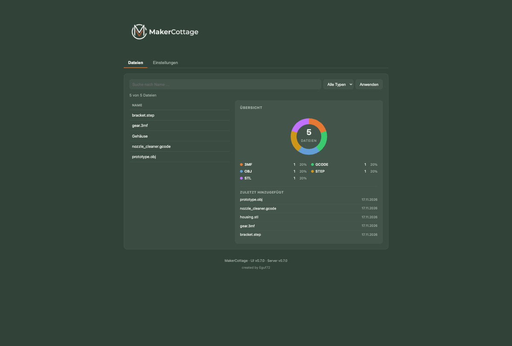
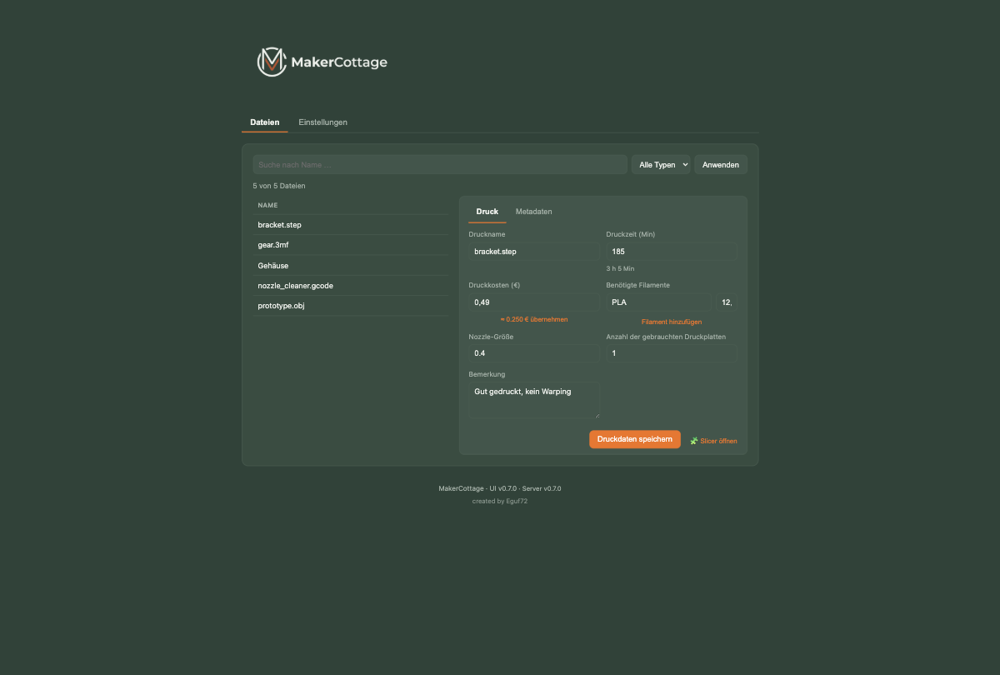
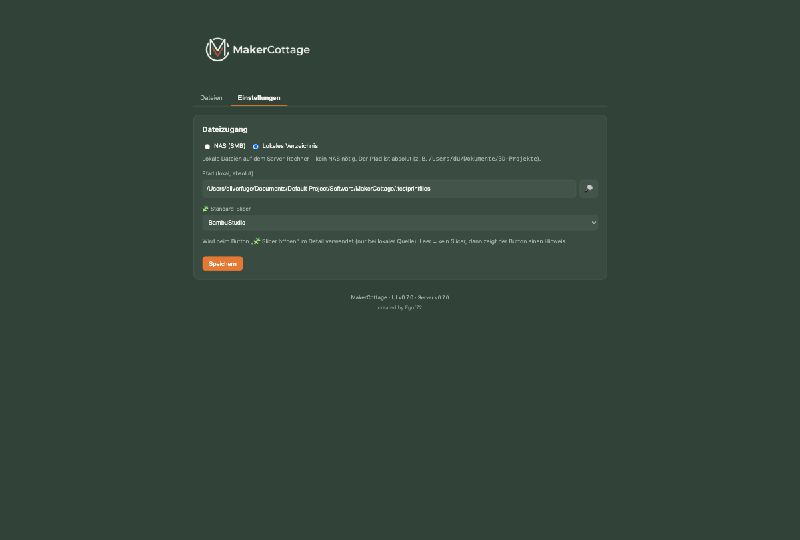

# MakerCottage


Ein schlanker **3D-Druck-Datei-Manager**: Er listet die Dateien eines **NAS**
(SMB) **oder** eines **lokalen Verzeichnisses** auf, erlaubt **Filter und Suche**
und speichert **Tags** und **Druckinformationen** pro Datei in einer lokalen
**SQLite**-Datei – ohne externe Datenbank.

Seit **v0.7.0** gibt es **native Desktop-Installer** für **macOS, Linux und
Windows** (gebaut über **GitHub Actions**), ein **Auto-GitHub-Release** und einen
**Remote-Update-Check** (`GET /api/update/check`). Die App ist bewusst klein
gehalten und für spätere Erweiterungen gebaut (3D-Vorschau, Druck-Schlange).

## Inhaltsverzeichnis

- [Screenshots](#screenshots)
- [Voraussetzungen](#voraussetzungen)
- [Installation](#installation)
- [NAS-Zugang eintragen](#nas-zugang-eintragen-2-wege)
- [Starten](#starten)
- [Projektstruktur](#projektstruktur)
- [Native Desktop-App (Electron)](#native-desktop-app-option-c--electron-v070)
- [Native Cross-Platform-Builds & Release](#native-cross-platform-builds--github-release-ci)
- [Aktualisieren](#aktualisieren-ohne-datenverlust)
- [Optik / Branding](#optik--branding)
- [Versionierung](#versionierung)
- [Funktionen](#funktionen)
- [API](#api)
- [Konfiguration](#konfiguration)
- [Datenbank](#datenbank-sqlite)

---

## Screenshots

Alle Screenshots zeigen **v0.7.0** (Footer: `MakerCottage · UI v0.7.0 · Server
v0.7.0`); Demo-Daten liegen in `.testprintfiles`.

| Datei-Übersicht | Detailfenster · Druck-Tab | Einstellungen |
|---|---|---|
|  |  |  |

- **Dateien:** Liste (nach Name) + **Übersicht**-Panel (Typ-Donut-Chart,
  „Zuletzt hinzugefügt"); Typ-Filter + Textsuche in der Kopfzeile.
- **Druck-Tab:** pro Datei editierbar – Druckname, Druckzeit, Druckkosten
  (automatische Schätzung `≈ (gramm/1000) × Referenzpreis`), Filamente
  (Material + Menge), Nozzle-Größe, Anzahl Druckplatten, Bemerkung.
- **Einstellungen:** Quelle wählen – **NAS (SMB)** oder **Lokales Verzeichnis**
  – Pfad-Picker + Standard-Slicer.

---

## Voraussetzungen
- **Node.js 18+** (am besten 20/22/26) – lokal ist v26 installiert.
- Entweder ein **NAS** mit **SMB**-Freigabe (im lokalen Netzwerk) **oder** ein
  **lokales Verzeichnis** auf dem Server-Rechner (absoluter Pfad).

## Installation
```bash
# 1) Backend
cd server
npm install

# 2) Frontend
cd ../web
npm install
```

## NAS-Zugang eintragen (2 Wege)
1. **Über die App:** Im Browser „NAS finden" nutzen oder Host/Share/Benutzer/Passwort
   eingeben und „Speichern" klicken. Die Daten liegen danach in
   `~/.makercottage/config.json` (lokal, Mode `0o600`).
2. **Per Datei:** `.env.example` als `server/.env` kopieren und ausfüllen
   (`.env` liegt im `.gitignore` und enthält Zugangsdaten; `config.json` liegt
   im Daten-Ordner `~/.makercottage/`).

## Starten
**Produktiv (ein Port – aktueller Betrieb):**
```bash
cd web && npm run build      # baut nach web/dist
cd ../server && npm start    # serviert Frontend + API unter http://localhost:4000
```
`@fastify/static` bedient `web/dist` direkt vom Disk → ein `npm run build` wirkt
**ohne** Server-Neustart; nur Code-Änderungen im Backend brauchen einen Neustart.

**Entwicklung (zwei Terminals):**
```bash
# Terminal 1 – Backend auf Port 4000
cd server && npm run dev
# Terminal 2 – Frontend auf Port 5173 (leitet /api an 4000 weiter)
cd web && npm run dev
```
Dann im Browser: **http://localhost:5173**

## Projektstruktur

```
makercottage/
├─ server/            # Backend (Fastify + better-sqlite3): API, Scan, Update-Check
├─ web/               # Frontend (Vite/React); version.js = Single Source of Truth
├─ electron/          # Native-Wrapper (Option C): main.js + electron-builder-Konfig
├─ launcher/          # Launcher-Kern (launcher.mjs): Kindprozess + openUI-Strategie
├─ scripts/           # Build-/Icon-Skripte (build-electron.sh/.ps1, generate-icons.sh)
├─ bin/               # Mitgelieferte Node-Binär (self-contained, pro Plattform)
├─ docs/screenshots/  # Aktuelle Screenshots (v070-*); _archive/ = frühere Stände
├─ FORTSCHRITT.md     # Protokoll / Changelog
├─ AUFGABEN.md        # Aufgaben / Backlog
└─ README.md          # diese Datei
```

> **Nutzer-Daten liegen nie im Code-Ordner:** DB + config wohnen in
> `~/.makercottage/` (`MC_HOME`, überschreibbar) und überstehen ein Update.

---

## Native Desktop-App (Option C / Electron, v0.7.0)

Seit **v0.7.0** ist der **Electron-Wrapper** fertig: ein **echtes natives
Fenster** (kein Browser), plattformübergreifend, gebaut über **GitHub Actions**.
Dazu gibt es fertige **Installers** für **macOS / Linux / Windows** im
[Release `v0.7.0`](https://github.com/Eguf72/makercottage/releases/tag/v0.7.0).

### Architektur (warum das „einfach" klappt)
Der **Server läuft im Bundle als Kindprozess auf der mitgelieferten `bin/node`**
(nicht auf der Electron-Runtime). Dadurch bleibt die `better-sqlite3`-ABI
stabil und man muss **nichts** re-kompilieren:

| Baustein | Verhalten |
|---|---|
| `better-sqlite3` (v13) | **N-API**-basiert, liefert **alle** Plattform-Prebuilds im npm-Paket mit → zur Laufzeit wird der passende `*.node` gewählt, **kein `electron-rebuild`** |
| `kerberos` / `krb-session-key` | ebenfalls N-API-Prebuilds (Fallback `node-gyp` nur, wenn ein Prebuild fehlt) |
| `bin/node` | **die einzige** plattformspezifische Sache → pro PLATFORM aus `nodejs.org` geladen (self-contained, nur System-Libs) |
| `openUI(url)` | injizierbare Strategie: **`mainWindow.loadURL(url)`** statt Browser-Öffnen |

`electron/main.js` ist bewusst schlank und **sicher**:
`contextIsolation: true`, `nodeIntegration: false` (kein IPC, kein Node im
Renderer); `MC_HOME = app.getPath('userData')` (plattform-nativ, Daten überleben
ein Update); sauberes Beenden über
`window.on('closed') → shutdown('SIGTERM')` und
`app.on('window-all-closed') → app.quit()` (non-macOS). `launch()` liefert
`{ child, shutdown }` zurück.

### Installer & Release-Assets
Das [Release `v0.7.0`](https://github.com/Eguf72/makercottage/releases/tag/v0.7.0)
enthält **5 Installer** (un-signiert, `UNSIGNED=1`):

| Plattform | Datei | Größe |
|---|---|---|
| **macOS** (arm64) | `MakerCottage-0.7.0-arm64.dmg` | ~190 MB |
| **macOS** (arm64) | `MakerCottage-0.7.0-arm64-mac.zip` | ~184 MB |
| **Linux** (x86_64) | `MakerCottage-0.7.0-x86_64.AppImage` | ~197 MB |
| **Linux** (x86_64) | `MakerCottage-0.7.0-amd64.deb` | ~152 MB |
| **Windows** (x64, NSIS) | `MakerCottage-Setup-0.7.0-x64.exe` | ~168 MB |

> **macOS Gatekeeper:** un-signierte `.dmg`/`.zip` werden evtl. mit „unklarer
> Quelle" blockiert → Rechtsklick → „Öffnen", oder
> `xattr -dr com.apple.quarantine <App>`.

---

## Native Cross-Platform-Builds & GitHub-Release (CI)

Der Workflow **`.github/workflows/electron-build.yml`** baut **alle drei
Plattformen parallel** (Matrix) und legt bei einem `v*`-Tag automatisch ein
**GitHub-Release** mit den Installer-Assets an.

```
matrix:
  macos-latest   → mac   / arm64 →  .dmg + .zip
  ubuntu-latest  → linux / x64   →  .AppImage + .deb
  windows-latest → win   / x64   →  Setup-*.exe  (NSIS)
```

Jeder Job: `actions/checkout` → `setup-node@v4` (Node 26, passend zu den
N-API-Prebuilds) → `setup-python@v5` (node-gyp-Fallback) → `bash
scripts/build-electron.sh` bzw. `pwsh scripts/build-electron.ps1`
(`UNSIGNED=1`, lädt pro Plattform die passende `bin/node` von `nodejs.org`) →
**nur** Installer-Dateien hochladen (`*.AppImage/*.deb/*.dmg/*.zip/*.exe`,
keine `*-unpacked/`-Verzeichnisse → vermeidet den „is a directory"-Fehler beim
Asset-Upload).

### Auslöser
| Trigger | Resultat |
|---|---|
| **`push` eines `v*`-Tags** | 3 Builds **+ Auto-Release** mit Installer-Assets |
| **`workflow_dispatch`** (Actions-Tab, „Run workflow") | 3 Builds, **kein** Release |

> **Wichtig – Tag-Verweis:** GitHub Actions lädt das Workflow-YAML aus dem
> Commit, auf den der **Tag** zeigt. Ein `v*`-Tag muss deshalb auf den
> **aktuellsten** Commit zeigen, sonst läuft ein veraltetes YAML. (In der
> Praxis hat ein zu altes Tag-Verweis erst „directory"/`--clobber`-Fehler
> erzeugt – seither auf den Fix-Commit `702f9ab` neu gesetzt.)
>
> **Praxis-Tipp:** Der `push`-Trigger kann vom YAML-Cache betroffen sein; ein
> **`workflow_dispatch`** im Actions-Tab ist der verlässliche Auslöser für einen
> manuellen Build. Für ein **Release** ist ein frisches `v*`-Tag nötig.

### Release-Notes (automatisch erzeugt)
Die Release-Notes enthalten einen kurzen Hinweis auf un-signierte Builds, die
Gatekeeper-Entwarnung (macOS) und dass **Nutzer-Daten** in `.makercottage`
(MC_HOME) ein Update überstehen.

---

## Aktualisieren (ohne Datenverlust)

Ein Update **überschreibt nur den Code, nicht die Daten** (DB + `config.json`
liegen in `~/.makercottage/`, also außerhalb des Code-Ordners). Deshalb:

1. **Neuen Installer/Ordner _daneben_ installieren** (neue Version neben der
   alten – nicht darüber).
2. Neue App starten; altes Profil bleibt erhalten.
3. Alle Nutzerdaten (DB in `~/.makercottage/makercottage.db`, `config.json`)
   bleiben **unberührt**. Alte Daten aus `.cache/makercottage.db` +
   `server/config.json` werden beim ersten Start automatisch nach
   `~/.makercottage/` migriert (Altkopien bleiben als Backup).

### Remote-Update-Check (`GET /api/update/check`, P2b)
Der UI-Footer meldet **„⚠ Update verfügbar v… · Herunterladen"**, sobald eine
neuere GitHub-Version da ist. Der Check läuft **serverseitig** (`server/updatecheck.js`)
– er umgeht den Browser-CORS gegen GitHub und antwortet auch bei Fehlern
graceful (`available:false`, kein Crash).

**Logik:** `current` (lokale `VERSION` aus `web/src/version.js`) wird gegen
`latest` (GitHub `releases/latest`, ohne `v`-Prefix, Prerelease-Teil
ausgeklammert) verglichen:

| `current` | `latest` | `available` |
|---|---|---|
| `0.6.0` | `0.7.0` | **`true`** (Update) |
| `0.7.0` | `0.7.0` | `false` |
| `0.8.0` | `0.7.0` | `false` |

Antwort: `{ current, latest, available, releaseTitle, releaseUrl, downloadUrl,
notes }`. Erst ein **existierendes** GitHub-Release mit Assets lässt den
Endpunkt sinnvoll antworten – dafür sorgt die CI oben.

> **Umgebung (optional):** `MC_UPDATE_REPO=owner/repo` (Default
> `Eguf72/makercottage`; leer = kein Remote-Check), `MC_UPDATE_GH_TOKEN`
> (Bearer → GitHub-Rate-Limit 60 → 5000/h), `MC_UPDATE_GITHUB_API`
> (GitHub-Enterprise/Proxy), `MC_UPDATE_TIMEOUT_MS` (8 s), `MC_UPDATE_CACHE_MS`
> (5 min). Siehe `FORTSCHRITT.md` v0.7.0 / T60.

---

## Optik / Branding
- **Logo:** transparentes SVG (`MakerCottage_logo.svg`), hellgrauer Schriftzug +
  orangener Pfeil, sitzt **direkt** auf dem Oliven-Grund (kein weißer Container).
  Höhe im Header: `168px`.
- **Favicon:** quadrates PNG (`MakerCottage_Favicon.png`, 1024) + `favicon-192/512`,
  über `manifest.json` registriert; `index.html` verweist auf PNG (kein JPG).
- **Farbschema** (`style.css :root`), harmonisiert auf den Oliven-Grund:
  | Variable | Wert | Bedeutung |
  |---|---|---|
  | `--bg` | `#384b41` | Hintergrund (Oliv) |
  | `--panel` | `#42564a` | Karten/Flächen |
  | `--panel-2` | `#4c6055` | Sekundär-Flächen |
  | `--text` | `#f0f2ee` | Haupttext |
  | `--muted` | `#aeb9b1` | Sekundärtext |
  | `--accent` | `#e8833a` | Akzent (Orange, passt zum Logo-Pfeil) |
  | `--border` | `#55685c` | Linien/Ränder |
- **Footer:** `MakerCottage · UI v<VERSION> · Server v<VERSION>` + eine zweite,
  gedämpfte Zeile `created by Eguf72`.
- **Icons:** `.icns` / `.ico` / `.png` werden aus `MakerCottage_Favicon.png`
  generiert (`scripts/generate-icons.sh`, Node-Fallback `scripts/ico-from-png.mjs`).

## Versionierung
Die Versionsnummer hat **eine einzige Quelle**: `web/src/version.js`
(`export const VERSION = '0.7.0'`); `server/package.json` und `web/package.json`
sind darauf abgestimmt. Der Footer importiert sie (`v{VERSION}`).

Schema `MAJOR.MINOR.PATCH` (Major bleibt `0`):

| Anlass | Aktion | Beispiel |
|---|---|---|
| Fehlerkorrektur | 3. Zähler (Patch) **+1** | `0.7.0 → 0.7.1` |
| Neue Funktion | 2. Zähler (Minor) **+1**, 3. auf **0** | `0.7.0 → 0.8.0` |

Nach jeder Änderung nur die `VERSION` in `version.js` anpassen, `npm run build`
(Produktivbetrieb ohne Neustart) und – für eine neue Version – einen `v*`-Tag
pushen (triggert Build + Release, siehe oben).

## Funktionen
- **Untermenü „Dateien / Einstellungen"** (Tab in der Kopfzeile, orange aktiv)
- Datei-Liste **nur nach Name** im Tab **„Dateien"** (Details im Detailfenster);
  Typ-Filter und Textsuche bleiben oben in der Leiste; standardmäßig nach Name
  aufsteigend sortiert. Angezeigt wird der **Druckname** (Platzhalter beim
  Scannen: der Dateiname), den man im Detailfenster beliebig überschreiben kann.
- **Übersicht-Panel** im Tab „Dateien": Typ-Verteilung (Donut-Chart) +
  „Zuletzt hinzugefügt".
- **Detailfenster:** klickbarer Dateiname öffnet einen Modal mit zwei Tabs
  (**Druck** aktiv / **Metadaten**), schließbar per ✕, ESC oder Hintergrund-Klick.
- **Druck-Tab:** pro Datei editierbar – Name, Druckzeit (Min), Druckkosten (€),
  benötigte Filamente (Material + Menge je Zeile, mehrfach), Nozzle-Größe,
  Anzahl Druckplatten, Bemerkung; **automatische Kostenschätzung**
  `(gramm/1000) × Referenzpreis` mit „≈ übernehmen".
- **Metadaten-Tab:** Endung, Größe, letzte Änderung, Erstellt (optional),
  **vollständiger Pfad**, DB-ID (optional).
- **SQLite-Persistenz** (`~/.makercottage/makercottage.db`): Metadaten, Tags und
  Druckdaten überleben ein Neuladen und einen neuen Scan (beim Scan werden die
  Druck-Felder nicht überschrieben).
- **Quelle wählen:** „NAS (SMB)" (Standard) oder **„Lokales Verzeichnis"** im
  Tab **„Einstellungen"**; `SOURCE` wird in `~/.makercottage/config.json` gespeichert.
- **Pfad-Picker:** Pfad durchstöbern statt tippen – Breadcrumb +
  „✓ Diesen Pfad wählen", funktioniert für NAS und lokal.
- **Native Desktop-App** (macOS / Linux / Windows) via Electron + GitHub-Actions-Release.
- **Remote-Update-Check** im Footer (serverseitig, CORS-sicher).
- NAS-Zugang über Formular + **Netzwerk-Suche** („NAS finden") im Tab **„Einstellungen"**
- Fehler-/Leerzustände
- Branding (Logo/Favicon/Oliv-Farbe) + Versions- & Credit-Zeile im Footer

## API
| Methode | Pfad | Zweck |
|---|---|---|
| GET  | `/api/config` | Aktuelle (öffentliche) Konfiguration – **ohne** Passwort |
| POST | `/api/config` | NAS-Zugang speichern |
| GET  | `/api/types` | Verfügbare Typen zum Filtern |
| GET  | `/api/nas/discover` | Netzwerk-Suche nach SMB-Diensten |
| POST | `/api/nas/shares` | Shares des NAS auflisten (Share-Picker) |
| POST | `/api/browse` | Unterverzeichnisse + Breadcrumb für den Pfad-Picker (NAS + lokal) |
| GET  | `/api/files?type=&q=&sort=&order=` | Gefilterte/sortierte Datei-Liste (indexiert die Funde) |
| GET  | `/api/db/files?type=&q=&tags=` | Indexierte Dateien aus der SQLite-DB |
| POST | `/api/db/scan` | Verzeichnis scannen + in die DB indexieren (`source`/`path`) |
| GET  | `/api/db/file?name=` | Einzelnen DB-Eintrag (Metadaten + Druckdaten + `pricePerKg`) |
| POST | `/api/db/file/tags` | Tags einer Datei aktualisieren (Upsert nach Name) |
| POST | `/api/db/file/print` | Druckinformationen einer Datei aktualisieren (Upsert nach Name) |
| GET  | `/api/db/settings?key=` | Einstellung(en) lesen (z. B. `filament_price_per_kg`) |
| POST | `/api/db/settings` | Einstellung schreiben (`key`/`value`) |
| GET  | `/api/update/check` | Remote-Update-Check gegen GitHub `releases/latest` (P2b) |

> **Referenzpreis** `filament_price_per_kg` (Standard `20` €/kg) liegt in der DB
> und wird von `GET /api/db/file` als `pricePerKg` mitgeliefert – er treibt die
> automatische Kostenschätzung im Druck-Tab. Er ist im UI nicht direkt editierbar.

## Konfiguration
| Variable | Standard | Bedeutung |
|---|---|---|
| `SOURCE` | `nas` | Quelle: `nas` (SMB) oder `local` (lokales Verzeichnis) |
| `NAS_HOST` | – | Host/IP des NAS |
| `NAS_SHARE` | – | Freigabe (Share) |
| `NAS_USER` | – | Benutzer |
| `NAS_DOMAIN` | – | Domain für Windows/AD-Shares (z. B. `CORP`); bei typischen NAS meist leer |
| `NAS_PASS` | – | Passwort |
| `NAS_PATH` | `/` | Zu scannender Ordner im Share |
| `NAS_PORT` | `445` | SMB-Port |
| `MAX_DEPTH` | `0` | Such-Tiefe (0 = nur direkte Ebene) |
| `PORT` | `4000` | Port des Backends |
| `MC_HOME` | `~/.makercottage` | Daten-Ordner (DB + config); überschreibbar |
| `MC_UPDATE_REPO` | `Eguf72/makercottage` | Remote-Update-Check (leer = aus) |

## Datenbank (SQLite)
Alle Dateien und ihre Metadaten werden in einer lokalen SQLite-Datei
(`~/.makercottage/makercottage.db`, Modul `server/database.js`, `better-sqlite3`)
gespeichert – ohne externe DB-Instanz.

> **Daten-Ort / Update ohne Datenverlust:** DB und config liegen seit v0.4.0 im
> stabilen Ordner **`~/.makercottage/`** (nicht im Code-Ordner). Über die
> Umgebungsvariable **`MC_HOME`** ist der Ort überschreibbar. Beim ersten Start
> migriert `server/paths.js` alte Daten aus `.cache/makercottage.db` und
> `server/config.json` einmalig, idempotent und **nicht destruktiv** (Altkopien
> bleiben als Backup) in den neuen Ordner – so überleben Nutzer-Daten ein
> Code-Update.

| Tabelle | Zweck |
|---|---|
| `file_index` | Je Datei ein Eintrag: Name, Endung, Typ, Größe, Pfad, `last_modified`, Tags + Druck-Felder |
| `scan_history` | Protokoll der Scans (Quelle, Pfad, Dateizahl, STEP-Zahl) |
| `settings` | Schlüssel-Wert-Einstellungen (z. B. `filament_price_per_kg`, `version`, `db_version`) |

- **Idempotentes Indexing:** Beim Auflisten (`GET /api/files`) und beim Scan
  (`POST /api/db/scan`) wird jede gefundene Datei idempotent upserted – ein
  Scan schreibt **nicht** in die Druck-Felder (`print_name`, `print_time_min`,
  `print_cost`, `filaments`, `nozzle_size`, `print_plates`, `print_notes`),
  damit gespeicherte Druckdaten über einen Neuscan hinweg erhalten bleiben.
- **Migration:** Fehlende Druck-Spalten werden bei Eröffnung idempotent
  nachgetragen (`ALTER TABLE … ADD COLUMN`, nicht destruktiv).
- `better-sqlite3` ist ein **natives Modul**, nutzt aber **N-API** → Prebuilds
  sind im Paket enthalten; bei einem echten Plattformwechsel ohne passenden
  Prebuild: `npm rebuild`/`npm install` im `server/` ausführen.
